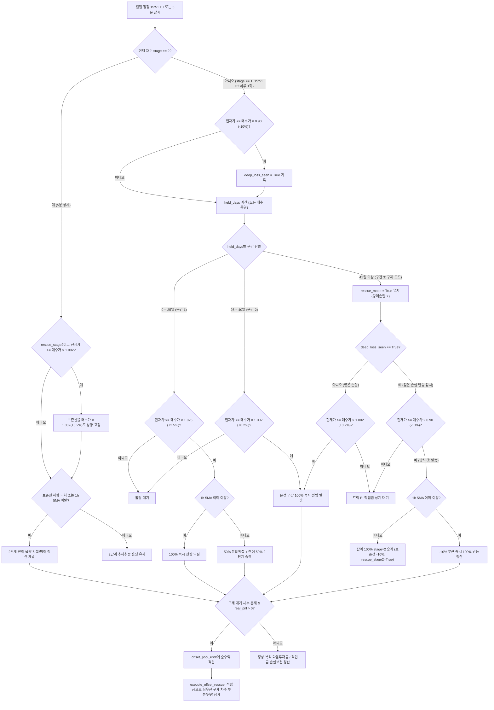

# 비트겟 떨사오팔 봇 — D 전략(구제 적립금 상계 청산) 및 보유일별 목표 수익률 단계적 하향(B 전략) 구현 계획서

- **최초 작성일시**: 2026-11-18 09:05 (KST)
- **최종 수정일시**: 2026-11-18 09:31 (KST)
- **대상 프로젝트**: `떨사오팔봇` (`Bitget SOXL/USDT:USDT` 무기한 선물 자동매매 봇)
- **주요 수정 예정 파일**:
  - [bitget_Ejftkdhvkf.py](file:///c:/Users/user/Desktop/trading_buddy/06비트겟자동매매-4기/week_02-bitget_Ejftkdhvkf/떨사오팔봇/bitget_Ejftkdhvkf.py)
  - [manual_buy.py](file:///c:/Users/user/Desktop/trading_buddy/06비트겟자동매매-4기/week_02-bitget_Ejftkdhvkf/떨사오팔봇/manual_buy.py)

---

## 1. 개요 및 도입 배경

### 1.1 기존 전략의 문제 진단
기존 [bitget_Ejftkdhvkf.py](file:///c:/Users/user/Desktop/trading_buddy/06비트겟자동매매-4기/week_02-bitget_Ejftkdhvkf/떨사오팔봇/bitget_Ejftkdhvkf.py#L576-L577)는 보유 기간이 `MAX_HOLD_DAYS_NORMAL = 40`일(고점 대비 `-40%` 대폭락 매수분은 `MAX_HOLD_DAYS_HIGH_DROP = 50`일)에 도달하면 수익률과 시장 반등 여력을 고려하지 않고 **기계적 타임컷(전량 강제 손절)**을 수행합니다([L1246-L1257](file:///c:/Users/user/Desktop/trading_buddy/06비트겟자동매매-4기/week_02-bitget_Ejftkdhvkf/떨사오팔봇/bitget_Ejftkdhvkf.py#L1246-L1257)).
- 평소 1회 익절(`+2.5%` ~ 2단계 추세추종)로 확보하는 수익은 회차당 수 달러 수준인 반면, 40일 타임컷 발생 시 SOXL 급락 구간 바닥에서 회차당 **-\$90 이상(`-50% ~ -60%`)의 대규모 확정 손실**이 발생합니다.
- 이 손익비 비대칭 때문에 2~3건의 연속 타임컷만으로도 수십 회 익절해 모은 누적 수익을 일시에 반납하며, 손절 직후 오는 SOXL 기술적 급반등의 수혜도 받지 못하는 구조적 한계가 있습니다.

### 1.2 해결 방향: B + D 하이브리드 매도 아키텍처 (보유일 기준 완전 통일)
타임컷의 대형 확정 손실 쇼크를 제거하면서도, 선물 교차 마진(`cross`) 계좌의 증거금 고갈 및 강제청산을 예방하기 위해 **일반 매수와 대폭락(1.5배) 매수 모두 동일한 `1~25일 / 26~40일 / 41일~` 보유일 기준으로 통일**한 3중 방어 매도 아키텍처를 구축합니다. *(대폭락 시 매수금 `1.5배` 증액 및 복리 가중치 `1.5`는 기존 그대로 유지합니다.)*

1. **타임컷 기준일 이전(`1~40일`) — B 전략 (보유일별 목표 수익률 하향)**
   - **1~25일 (`0 <= held_days <= 25`)**: 기존 전략 그대로 **`+2.5%`** 목표 (+ 2단계 `1h 5MA` 추세추종)
   - **26~40일 (`26 <= held_days <= 40`)**: 욕심을 내려놓고 **`+0.2%`(수수료·펀딩비 충당 본전선)**에만 도달해도 즉시 100% 자력 탈출하여 41일차 장기 미결 물량으로 넘어가는 것을 최대한 방지합니다.
2. **타임컷 기준일 이후(`41일~`) — D 전략 (기계적 강제 손절 폐지 & 구제 모드 2트랙 탈출)**
   - 41일차(`held_days >= 41`)부터는 기계적 바닥 손절을 폐지하고 **‘구제 모드(`rescue_mode = True`)’**로 전환하여 두 트랙을 병행 가동합니다.
   - **트랙 A (방식 ② 손실 최소화 반등 추세추종)**: 깊은 손실(`-10%` 이하)을 겪은 차수가 반등해 **`-10%` 선**에 도달하면, 이미 `1h 5MA`가 꺾인 경우에만 `-10%` 부근에서 즉시 탈출하고 상승 추세가 살아있다면 **`-10%`를 최저보존선으로 걸고 `stage = 2`(`1h 5MA`) 추세추종**을 태워 손실을 최대한 줄이거나(본전 `+0.2%` 돌파 시 보존선 자동 상향 래칫 작동) 수익 전환까지 노립니다.
   - **트랙 B (D 전략 구제 적립금 상계 소각)**: 반등이 더딘 동안 하위 차수들이 익절할 때마다 발생한 순이익을 **구제 적립금(`offset_pool_usdt`)**에 모아, 최상단 구제 대기 차수의 물량을 비트겟 최소 주문금액 이상 단위로 **부분/전량 상계 소각(계좌 합산 실현손익 `\$0` 방어)**합니다.
3. **선물 계좌 보호 브레이크 (강제청산 방지 안전벨트)**
   - 무반등 장기 하락장에서 차수가 무한 누적되어 Bitget 교차 마진 유지증거금이 잠식되는 것을 막기 위해, **최대 보유 차수 상한(`15개`)**과 **다차수(`10개` 이상) 보유 시 매수 조건 강화(`-1.5%` → `-3.0%`)** 장치를 병행합니다.

---

## 2. 보유 기간별 3단계 매도 생애주기 설계 (일반/대폭락 매수 통일)

차수별 보유 경과일 `held_days = (today - buy_date).days` 기준, `고점대비하락조건` 유무와 상관없이 모든 차수에 동일한 3단계 생애주기를 적용합니다.

| 구간 | 보유 경과일 (통일) | 1차 목표 / 트리거 기준 | 매도 실행 방식 |
|---|---|---|---|
| **구간 1 (정상 수익 추구)** | **`0 ~ 25일`**<br>(`held_days <= 25`) | **`+2.5%`**<br>(`SELL_PROFIT_PCT = 0.025`) | 기존과 동일: 일일 점검(`15:51 ET`) 시 목표가 도달하면 설정 비율(`50%`) 즉시 분할익절 + 잔여 `50%`는 2단계(`1h 5MA`) 추세추종 승격 (이미 추세 이탈 시 100% 즉시 익절) |
| **구간 2 (본전 탈출 구간)** | **`26 ~ 40일`**<br>(`26 <= held_days <= 40`) | **`+0.2%`**<br>(`STEPDOWN_BREAKEVEN_PCT = 0.002`) | 일일 점검(`15:51 ET`) 시 매도 수수료(`0.06%`)를 감안한 본전선(`매수가 × 1.002`) 도달 시 2단계 승격 없이 **즉시 100% 전량 탈출** |
| **구간 3 (구제 모드 전환)** | **`41일 이상`**<br>(`held_days >= 41`) | **강제 손절 폐지**<br>① 깊은 손실(`deep_loss_seen=True`) 반등선 **`-10.0%`**<br>② 얕은 손실(`deep_loss_seen=False`) 본전선 **`+0.2%`** | **트랙 A (방식 ② 손실 최소화 추세추종)**: 일일 점검 시 `-10%` 회복 & `1h 5MA` 상승 유지 시 **잔여 100%를 `stage = 2`(최저보존선 `-10%`) 추세추종 승격** (이미 `1h 5MA` 꺾였으면 즉시 전량 청산). 추세추종 중 **`+0.2%` 돌파 시 보존선을 `+0.2%`로 자동 상향**.<br>**트랙 B (D 전략 구제 적립금 상계)**: `stage = 1` 구제 대기 중 하위 차수 익절 수익(`offset_pool_usdt`)으로 최우선 구제 차수부터 부분/전량 상계 소각 |

### 2.1 41일차 ‘절벽 손절’ 방지 메커니즘 (`deep_loss_seen` 플래그)
- 단순히 `41일 이상 & 수익률 >= -10%`로 구현하면, 40일째에 **`-3%`(본전 코앞)**에서 잘 버티던 차수가 41일째 아침이 되자마자 `-3% >= -10%` 조건을 만족해 **반등도 아닌데 즉시 손절되는 부작용(절벽 손절)**이 발생합니다.
- 이를 막기 위해 차수별로 `deep_loss_seen` (깊은 손실 이력) 플래그를 관리합니다:
  1. 차수 상태 점검 시 한 번이라도 `현재가 <= 매수가 × (1 + RESCUE_REBOUND_TRIGGER_PCT)` (즉 `매수가 × 0.90`, `-10%` 이하)를 기록한 경우 `deep_loss_seen = True`로 영구 기록합니다. *(현재 `-50%` 부근에 물려 있는 기존 차수들은 코드 적용 첫 실행 시 자동으로 `deep_loss_seen = True`로 초기화됩니다.)*
  2. **얕은 손실 상태로 41일차에 진입한 차수(`deep_loss_seen == False`, 예: `-0.1% ~ -9.9%`)**: 억지 손절 없이 **`+0.2%` 본전 탈출선**만 바라보며 홀딩하거나, 아주 적은 구제 적립금으로 손실 `\$0` 상계 완판합니다. (추후 가격이 `-10%` 이하로 빠질 때만 `deep_loss_seen = True`로 전환)
  3. **깊은 손실을 겪은 뒤 반등한 차수(`deep_loss_seen == True`)**: 반등하여 `-10%` 선을 회복할 때 **방식 ② 손실 최소화 추세추종**을 정상 발동합니다.

### 2.2 전체 매도 흐름도



---

## 3. D 전략(구제 적립금 상계 청산) 및 방식 ② 정산 상세 명세

### 3.1 구제 적립금(`offset_pool_usdt`) 적립 규칙
1. **적립 활성화 조건**:
   - 현재 미매도 활성 차수 중 구간 3(`held_days >= 41` 이고 `rescue_mode == True`, 아직 `stage == 1` 상계 대기 중)인 **구제 대상 차수가 1개 이상 존재할 때만** 수익 적립을 활성화합니다.
   - 구제 대상 차수가 0개일 때는 기존 방식 그대로 수익의 100%를 복리 `다음투자금` 성장에 반영합니다. *(이전에 남은 `offset_pool_usdt` 잔액이 있다면 `0`으로 초기화하지 않고 다음 구제 상황까지 그대로 이월 보관합니다.)*
2. **적립 대상 체결 및 적립 금액**:
   - 구제 상계 매도가 아닌 **정상 익절 매도**(1단계 50% 분할익절, 구간 1 100% 즉시 익절, 구간 2 `+0.2%` 본전 익절, 기존 2단계 최종 익절 및 수익 전환한 구제 2단계 익절)에서 발생한 매도 수수료(`SELL_FEE_RATE = 0.0006`) 차감 후 순실현이익 $\text{real\_pnl} > 0$ 에 대해 적립합니다.
   - 적립 공식:
     $$\Delta \text{pool} = \text{real\_pnl} \times \text{OFFSET\_PROFIT\_SAVE\_RATIO} \quad (\text{기본값 } 1.0 = 100\%)$$

### 3.2 구제 추세추종(`rescue_stage2 == True`) 청산 및 복리(`다음투자금`) 정산 규칙
1. **구제 2단계(`rescue_stage2 = True`) 진행 중 래칫(Ratchet) 및 청산**:
   - 일일 점검 시 `-10%` 회복과 함께 `1h 5MA` 상승 추세가 확인되면, 분할 매도 없이 남은 수량 100%를 `stage = 2`, `rescue_stage2 = True`, `preservation_line = buy_price * 0.90`으로 승격합니다.
   - **본전 보존선 자동 상향**: 이후 5분 감시 도중 `현재가 >= buy_price * 1.002` (`+0.2%`)가 되고 현재 `preservation_line < buy_price * 1.002`이면, `preservation_line`을 **`buy_price * 1.002`**로 즉시 상향 저장하여 확보한 본전을 잠금(Lock-in)합니다.
   - 최종 청산 시(보존선 방어 또는 `1h 5MA` 이탈, 혹은 일일 점검 시 이미 추세가 꺾여 `-10%` 선에서 즉시 반등 청산된 경우 포함):
     - 만약 **손실 상태로 청산(`real_pnl < 0`, 예: `-8%` 청산)** 되었다면:
       - `offset_pool_usdt > 0`인 경우 보유 적립금에서 최대 $\text{abs}(\text{real\_pnl})$ 만큼 우선 차감(`covered_usdt = min(offset_pool_usdt, abs(real_pnl))`)하여 손실을 상쇄합니다.
       - 적립금으로 다 메우고도 남은 순손실 비율(`uncovered_loss_pct = profit_pct * (1 - covered_usdt / abs(real_pnl))`)만 복리 `다음투자금` 조정률 계산에 반영합니다. (적립금으로 100% 메웠다면 `다음투자금` 감액 없음)
     - 만약 **수익 전환(`real_pnl >= 0`)으로 청산**되었다면 적립금을 전혀 차감하지 않으며, 다른 구제 대기 차수가 남아있다면 오히려 그 순수익을 `offset_pool_usdt`에 적립할 수 있습니다.
2. **하위 차수 및 적립금 상계 차수의 복리 정산 왜곡 방지**:
   - 하위 차수 수익금 중 `OFFSET_PROFIT_SAVE_RATIO` 비율만큼 구제 적립금으로 빠져나간 경우에는, 구제 적립에 기여하지 않은 잔여 비율`(1 - OFFSET_PROFIT_SAVE_RATIO)`만 `adj_pct`에 반영합니다. (기본값 `1.0`에서는 구제 모드 가동 기간 중 `다음투자금`이 동결되어 과잉 복리 팽창을 막음)
   - 트랙 B(적립금 부분/전량 상계 소각)로 완결된 차수는 손실이 이미 적립금으로 상쇄되었으므로 `다음투자금`을 이중 감액하지 않습니다.

### 3.3 트랙 B 구제 대상 우선순위 및 상계 수량 계산식
1. **집중 소각 우선순위**:
   - `rescue_mode == True` 이고 `stage == 1` (2단계 반등 추세추종에 진입하지 않고 대기 중)인 활성 차수 중 **① `매수일`이 가장 오래된 차수 우선**, **② 매수일이 같으면 `매수가`가 가장 높은 최상단 차수 우선**으로 1개 차수를 집중 타겟팅하여 차수 개수를 빠르게 줄입니다.
   *(구제 2단계 `rescue_stage2 == True`로 이미 반등 추세를 타고 있는 차수는 알아서 손실을 줄이며 나오는 중이므로 트랙 B 적립금 소각 대상에서 제외해 적립금을 다른 물린 차수에 아껴 씁니다.)*
2. **1주당 순손실액(`loss_per_share`) 계산**:
   - 대상 차수의 매수가 $B$, 현재 비트겟 선물가 $P_{\text{curr}}$, 매도 수수료율 $f = 0.0006$ 기준:
     $$\text{loss\_per\_share} = B - P_{\text{curr}} \times (1 - f)$$
   - 만약 $\text{loss\_per\_share} \le 0$ 이라면 손실이 없는 상태이므로 적립금 차감 없이 즉시 자력 전량 청산합니다.
3. **상계 가능 수량(`raw_offset_qty`)**:
   $$Q_{\text{raw}} = \frac{\text{offset\_pool\_usdt}}{\text{loss\_per\_share}}$$

### 3.4 비트겟 최소 주문금액(`5 USDT`) 및 잔여 더스트(Dust) 방지 로직
비트겟 거래소는 주문 금액이 `5 USDT` 미만이면 주문을 거절합니다([bitget_Ejftkdhvkf.py#L34](file:///c:/Users/user/Desktop/trading_buddy/06비트겟자동매매-4기/week_02-bitget_Ejftkdhvkf/떨사오팔봇/bitget_Ejftkdhvkf.py#L34), [L186](file:///c:/Users/user/Desktop/trading_buddy/06비트겟자동매매-4기/week_02-bitget_Ejftkdhvkf/떨사오팔봇/bitget_Ejftkdhvkf.py#L186)). 부분 매도 후 애매한 소량(더스트)이 남아 향후 전량 청산이 불가능해지는 사고를 막기 위해 2가지 분기로 엄격히 검증합니다.

- **케이스 ① 전량 상계 가능 ($Q_{\text{raw}} \ge Q_{\text{rem}}$)**:
  - 남은 수량 $Q_{\text{rem}}$ 전량을 즉시 청산(`place_close_long`, `reduceOnly=True`)합니다.
  - 체결 확인 후 실제 체결가 $P_{\text{exec}}$, 실제 체결수량 $Q_{\text{exec}}$ 로 확정된 실제 손실액만 적립금에서 차감합니다:
    $$\text{actual\_loss} = \max\Bigl(0,\ \bigl(B - P_{\text{exec}} \times (1 - f)\bigr) \times Q_{\text{exec}}\Bigr)$$
  - `offset_pool_usdt -= actual_loss` 차감 후 남은 적립금은 그대로 보존되어 다음 구제 차수로 이월됩니다.

- **케이스 ② 부분 상계 ($Q_{\text{raw}} < Q_{\text{rem}}$)**:
  1. 거래소 수량 정밀도 내림 보정: $Q_{\text{part}} = \text{amount\_to\_precision}(Q_{\text{raw}})$ (예상 손실액이 `offset_pool_usdt`를 초과하지 않도록 필요 시 1스텝 하향 보정).
  2. **최소 주문금액 검증**: $Q_{\text{part}} \times P_{\text{curr}} < \text{MIN\_OFFSET\_ORDER\_USDT}$ (`10.0 USDT`, 거래소 최소 `5 USDT`의 2배 안전마진)이면 주문하지 않고 적립금이 더 모일 때까지 대기합니다.
  3. **잔여 더스트(Dust) 방지 검증**: 부분 매도 후 남게 될 잔여 수량의 평가금액 $(Q_{\text{rem}} - Q_{\text{part}}) \times P_{\text{curr}}$ 이 안전 하한선(`MIN_REMAINING_DUST_USDT = 6.0 USDT`) 미만인 경우, 남는 수량이 최소 `6.0 USDT` 이상 유지되도록 $Q_{\text{part}}$ 를 축소 재계산합니다:
     $$Q_{\text{part\_adj}} = \text{amount\_to\_precision}\!\left(Q_{\text{rem}} - \frac{\text{MIN\_REMAINING\_DUST\_USDT}}{P_{\text{curr}}}\right)$$
     축소된 $Q_{\text{part\_adj}} \times P_{\text{curr}}$ 도 `MIN_OFFSET_ORDER_USDT`(`10.0 USDT`) 이상일 때만 부분 매도를 실행하며, 미달 시 전량 완판 가능한 적립금이 모일 때까지 안전 대기합니다.
  4. 실제 체결 확인 후 확정 손실액 $\max(0, (B - P_{\text{exec}}(1-f)) \times Q_{\text{exec}})$ 만큼 `offset_pool_usdt`에서 차감합니다 (최소 0 하한 보정).

---

## 4. 선물 계좌 보호용 매수 브레이크 (강제청산 방지 안전벨트)

기계적 타임컷을 폐지하고 구제 소각·반등 추세추종을 기다리는 동안, 무반등 장기 하락장에서 차수가 과도하게 불어나 Bitget 교차 마진(`cross`)이 강제청산되는 리스크를 구조적으로 차단합니다.

1. **최대 보유 차수 상한 (`MAX_ACTIVE_ROUNDS = 15`)**
   - 기존 [가능다음차수()](file:///c:/Users/user/Desktop/trading_buddy/06비트겟자동매매-4기/week_02-bitget_Ejftkdhvkf/떨사오팔봇/bitget_Ejftkdhvkf.py#L1170-L1182)의 `39`차수 제한을 `MAX_ACTIVE_ROUNDS = 15`로 축소합니다.
   - 미매도 활성 차수가 `15개` 이상이면 `가능다음차수()`가 `None`을 반환하고, [매수체크()](file:///c:/Users/user/Desktop/trading_buddy/06비트겟자동매매-4기/week_02-bitget_Ejftkdhvkf/떨사오팔봇/bitget_Ejftkdhvkf.py#L1730-L1893)에서 신규 주문을 보류한 뒤 텔레그램으로 상한 도달 안내를 발송합니다.
2. **다차수 과부하 구간 매수 조건 강화 (`HEAVY_HOLD_ROUND_THRESHOLD = 10`, `HEAVY_HOLD_BUY_DROP_PCT = 0.030`)**
   - 미매도 활성 차수가 `10개` 이상 쌓인 하락장 구간에서는 당일 시가 대비 `-1.5%`(`BUY_DROP_PCT`) 하락만으로는 매수하지 않고, **`-3.0%` 이상 급락할 때만** 추가 매수하여 바닥권 탄약 집중 및 청산가 관리를 도모합니다.

---

## 5. 신규 및 변경 설정 상수 일람표

[bitget_Ejftkdhvkf.py](file:///c:/Users/user/Desktop/trading_buddy/06비트겟자동매매-4기/week_02-bitget_Ejftkdhvkf/떨사오팔봇/bitget_Ejftkdhvkf.py#L570-L605)의 전략 설정 영역에 반영할 파라미터입니다.

| 상수명 | 기본값 | 설명 |
|---|---|---|
| `MAX_HOLD_DAYS_NORMAL` | `40` | 일반 매수 구제 모드 전환 전 기준일 (`0~25일` 수익, `26~40일` 본전, `41일~` 구제) |
| `MAX_HOLD_DAYS_HIGH_DROP` | `40` | 대폭락(1.5배) 매수도 일반 매수와 동일하게 **`40일` 기준으로 통일** (기존 `50` → `40`) |
| `ENABLE_HARD_TIMECUT` | `False` | `True`면 기존 강제 전량 손절, `False`면 강제 손절 폐지 및 구제 모드(D+방식②) 가동 |
| `STEPDOWN_BREAKEVEN_START_DAYS` | `26` | 본전 탈출 구간 시작 경과일 (`26 ~ 40일`, `0 ~ 25일`은 기존 `+2.5%` 적용) |
| `STEPDOWN_BREAKEVEN_PCT` | `0.002` | `26~40일` 구간, 얕은 손실 구제 차수 탈출선 및 구제 2단계 본전 래칫 기준 (`+0.2%`) |
| `ENABLE_OFFSET_RESCUE` | `True` | D 전략(구제 적립금 적립 및 상계 청산) 활성화 여부 |
| `RESCUE_REBOUND_TRIGGER_PCT` | `-0.10` | `41일~` 깊은 손실 차수의 반등 추세추종(`stage=2`) 진입 및 초기 보존선 기준 (`-10.0%`) |
| `OFFSET_PROFIT_SAVE_RATIO` | `1.0` | 구제 대상 보유 중 하위 차수 익절 순수익 중 구제 적립금 적립 비율 (`1.0` = `100%`) |
| `MIN_OFFSET_ORDER_USDT` | `10.0` | 부분 상계 주문 1회 최소 실행 금액 (`USDT`, 비트겟 최소 `5 USDT` 대비 2배 안전마진) |
| `MIN_REMAINING_DUST_USDT` | `6.0` | 부분 상계 후 남아야 할 최소 잔여 포지션 평가금액 (`USDT`, 자투리 미청산 방지) |
| `MAX_ACTIVE_ROUNDS` | `15` | 최대 동시 보유 허용 차수 (기존 `39` 대체, 초과 시 신규 매수 보류) |
| `HEAVY_HOLD_ROUND_THRESHOLD` | `10` | 매수 기준 강화 모드가 발동되는 미매도 보유 차수 기준 (`10개` 이상) |
| `HEAVY_HOLD_BUY_DROP_PCT` | `0.030` | 다차수 과부하 구간에서 적용할 강화된 당일 시가 대비 하락 매수 기준 (`-3.0%`) |

---

## 6. 원장(`비트겟떨사오팔_매매기록.xlsx`) 및 상태 파일(`bitget_round_state.json`) 스키마 설계

### 6.1 `bitget_round_state.json` 확장 스키마
종목별(`state["SOXL"]`) 루트 레벨에 적립금 총량을 관리하고, 각 차수별(`rounds[r_key]`) 객체에 부분 상계 및 구제 추세추종 상태를 저장합니다.

```json
{
  "SOXL": {
    "offset_pool_usdt": 18.4520,
    "offset_total_used_usdt": 42.1000,
    "rounds": {
      "1": {
        "stage": 1,
        "buy_price": 42.50,
        "initial_quantity": 3.5,
        "quantity": 2.4,
        "part1_sold_qty": 0.0,
        "part1_sold_price": null,
        "part1_sold_pct": null,
        "part1_sold_at": null,
        "target_price": 43.5625,
        "preservation_line": 43.5625,
        "stage2_entered_at": null,
        "rescue_mode": true,
        "deep_loss_seen": true,
        "rescue_stage2": false,
        "offset_sold_qty": 1.1,
        "offset_sold_proceeds": 24.75,
        "offset_used_usdt": 21.98,
        "offset_count": 2
      }
    }
  }
}
```

### 6.2 엑셀 `매매기록` 시트 정합성 및 자가 복원(`sync_round_state_from_excel`)
1. **부분 상계 진행 중 상태 유지**:
   - 부분 상계 매도가 진행 중인 동안에는 해당 차수 행의 `매도가`, `매도일`, `매도수량`을 비워두어(`NaN`) 미매도 활성 차수로 유지합니다.
   - 보조 컬럼 **`구제상계수량`**, **`구제상계금액`**에 부분 상계 체결 내역을 누적 기록하여 `수량` 컬럼(최초 매수 수량 $Q_{\text{init}}$)은 그대로 보존합니다.
2. **자가 복원(Self-Healing) 무결성 보장**:
   - `bitget_round_state.json` 파일이 손상·유실되더라도 `sync_round_state_from_excel()`이 엑셀의 `수량`, `구제상계수량`, `구제상계금액`을 읽어 실제 거래소 잔여 수량($Q_{\text{rem}} = Q_{\text{init}} - Q_{\text{offset\_sold}}$)을 정확히 복원합니다.
   - 매수가 내림차순 `1~N차` 앞당김 정렬 시에도 `(매수가, initial_quantity)` 매칭 로직이 `rescue_mode`, `deep_loss_seen`, `rescue_stage2`, `offset_sold_qty`, `offset_sold_proceeds`, `offset_used_usdt`, `offset_count` 및 기존 `part1_*` 필드를 유실 없이 보존합니다.
   - 특히 `has_active_stage2_rounds()`([L549-L554](file:///c:/Users/user/Desktop/trading_buddy/06비트겟자동매매-4기/week_02-bitget_Ejftkdhvkf/떨사오팔봇/bitget_Ejftkdhvkf.py#L549-L554))는 기존 그대로 `stage == 2` 여부만 검사하므로, 구제 차수가 `-10%` 반등 추세추종(`stage = 2`, `rescue_stage2 = True`)으로 승격하면 **별도의 스케줄러 수정 없이 자동으로 5분 간격 24시간 실시간 감시가 활성화**됩니다.
3. **최종 완판 시 엑셀 1줄 완결 및 손익차트 정확성**:
   - 구제 차수가 마지막 잔여 물량까지 모두 청산되면, 아래와 같이 가중평균 매도가와 총 매도 수량(100%)을 기입해 엑셀 행을 닫습니다.
     $$\text{합산 평균매도가} = \frac{\text{part1\_sold\_price} \times \text{part1\_sold\_qty} + \text{offset\_sold\_proceeds} + P_{\text{final}} \times Q_{\text{final}}}{\text{part1\_sold\_qty} + \text{offset\_sold\_qty} + Q_{\text{final}}}$$
   - `손익차트` 시트는 완결된 행들의 실제 매도가 기준 실현손익을 집계하므로, 실제 Bitget 계좌 잔고 변동과 정확히 일치합니다.

---

## 7. 파일별 상세 코드 변경 위치 및 구현 명세 (`/apply` 실행 가이드)

### 7.1 [bitget_Ejftkdhvkf.py](file:///c:/Users/user/Desktop/trading_buddy/06비트겟자동매매-4기/week_02-bitget_Ejftkdhvkf/떨사오팔봇/bitget_Ejftkdhvkf.py)

1. **상태 파일 관리 확장 (`L395-L548`)**
   - `get_offset_pool(stock_code)`, `add_offset_pool(stock_code, amount_usdt)`, `consume_offset_pool(stock_code, used_usdt)` 헬퍼 함수를 신설합니다.
   - `sync_round_state_from_excel()`([L395-L495](file:///c:/Users/user/Desktop/trading_buddy/06비트겟자동매매-4기/week_02-bitget_Ejftkdhvkf/떨사오팔봇/bitget_Ejftkdhvkf.py#L395-L495))에서 `stock_dict["offset_pool_usdt"]`, `offset_total_used_usdt`를 유지하며, 행별 매칭 시 `rescue_mode`, `deep_loss_seen`, `rescue_stage2`, `offset_sold_qty`, `offset_sold_proceeds`, `offset_used_usdt`, `offset_count` 필드를 보존하고 JSON 부재 시 엑셀 보조 컬럼에서 복원합니다.
   - `update_round_stage()`([L497-L539](file:///c:/Users/user/Desktop/trading_buddy/06비트겟자동매매-4기/week_02-bitget_Ejftkdhvkf/떨사오팔봇/bitget_Ejftkdhvkf.py#L497-L539))에 해당 신규 선택 인자들을 추가합니다.
2. **전략 상수 및 동적 목표 프로필 함수 추가 (`L570-L615`)**
   - 섹션 5의 전략 상수(`MAX_HOLD_DAYS_HIGH_DROP = 40` 통일 포함)를 반영합니다.
   - `get_round_target_profile(held_days)` 함수를 추가하여 `(target_pct, allow_stage2, is_rescue_mode, phase_label)`을 반환합니다 (`held_days <= 25` → `+2.5%`, `26 <= held_days <= 40` → `+0.2%`, `held_days >= 41` → 구제 모드).
3. **최대 보유 차수 상한 반영 (`L1170-L1182`, `가능다음차수`)**
   - 기존 `if active_cnt < 39:` 비교를 `if active_cnt < MAX_ACTIVE_ROUNDS:`로 변경합니다.
4. **`매도체크()` 개편 및 `execute_offset_rescue()` 신설 (`L1193-L1684`)**
   - **잔여 수량 계산(`L1240-L1243`)**: `offset_sold_qty`를 반영해 실제 거래소 잔여 수량 `quantity = max(0.0, initial_quantity - part1_sold_qty - offset_sold_qty)`을 산출합니다.
   - **깊은 손실 이력(`deep_loss_seen`) 갱신**: `매도체크()` 순회 시 `current_price <= buy_price * (1.0 + RESCUE_REBOUND_TRIGGER_PCT)`(`매수가 × 0.90`) 조건에 해당하면 `deep_loss_seen = True`로 업데이트합니다.
   - **기존 타임컷 분기(`L1246-L1257`) 및 `current_stage == 1` 개편(`L1260-L1386`)**:
     - `ENABLE_HARD_TIMECUT == True`일 때만 기존 강제 전량 청산을 실행합니다.
     - `held_days >= 41` (`ENABLE_HARD_TIMECUT == False`)인 `current_stage == 1` 차수는 `rescue_mode = True`로 등록하고:
       - `deep_loss_seen == False` (얕은 손실): 일일 점검 시 `매수가 × (1 + STEPDOWN_BREAKEVEN_PCT)`(`+0.2%`) 도달 시 즉시 100% 자력 탈출합니다.
       - `deep_loss_seen == True` (깊은 손실 후 반등 감시): 일일 점검 시 `매수가 × (1 + RESCUE_REBOUND_TRIGGER_PCT)`(`-10%`) 이상 도달하면:
         - `is_ma5_broken == True` → 즉시 100% 반등 청산(`sell_orders` 추가).
         - `is_ma5_broken == False` → 분할 없이 **잔여 100%를 `stage = 2`, `rescue_stage2 = True`, `preservation_line = buy_price * 0.90`으로 승격**하고 텔레그램(`🛟 [구제 반등 추세추종 승격]`) 발송.
     - `held_days <= 40` 차수는 `get_round_target_profile(held_days)`를 적용하여 `0~25일`은 `+2.5%` 분할익절+2단계, `26~40일`은 `+0.2%` 도달 시 즉시 100% 전량 탈출로 분기합니다.
   - **`current_stage == 2` 구제 래칫(Ratchet) 추가(`L1389-L1414`)**:
     - `rescue_stage2 == True`인 2단계 차수가 `현재가 >= buy_price * (1.0 + STEPDOWN_BREAKEVEN_PCT)`(`+0.2%`)에 도달하면 `preservation_line`을 `buy_price * (1.0 + STEPDOWN_BREAKEVEN_PCT)`로 상향 저장하고 텔레그램(`🛡️ [구제 추세추종 본전 잠금]`)을 발송한 뒤 보존선 방어 및 `1h 5MA` 감시를 계속합니다.
   - **`sell_orders` 체결 및 정산(`L1415-L1546`)**:
     - 구제 차수(`rescue_stage2 == True` 또는 `-10%` 반등 즉시 청산)가 손실 상태로 청산(`real_pnl < 0`)된 경우, `offset_pool_usdt`에서 `min(pool, abs(real_pnl))`을 우선 차감해 손실을 상계하고 미보전 손실분만 `adj_pct`에 반영합니다.
     - 구제 대기(`rescue_mode == True` & `stage == 1`) 차수가 존재하고 정상 익절(`real_pnl > 0`)이 발생한 경우, `add_offset_pool()`로 `real_pnl * OFFSET_PROFIT_SAVE_RATIO`를 적립하고 복리 `다음투자금` 증액을 적립 비율만큼 보정합니다.
   - **`execute_offset_rescue()` 실행(`L1548` 직후)**:
     - `ENABLE_OFFSET_RESCUE == True`이고 `offset_pool_usdt > 0`이며 `rescue_mode == True & stage == 1` 차수가 존재할 때 3.3~3.4절 로직에 따라 부분/전량 상계 주문 및 엑셀·JSON·텔레그램(`🛟 [구제 부분/전량 상계 청산]`)·구글 시트 로깅을 수행합니다.
   - **브리핑 메시지 및 `STATE_SYNC` 고도화(`L1555-L1683`)**:
     - `rounds_detail_lines`에 차수별 구간 표기(`정상 +2.5%`, `본전탈출 +0.2%`, `🛟구제(-10% 반등추종 대기)` / `🛟구제(+0.2% 본전대기)`, `🛟구제추세(보존선 XX.XX)`)와 `구제전환일` 및 하단 **`🏦 구제 적립금 잔액: \$XX.XX USDT`**를 표시하고 `STATE_SYNC` 페이로드에 `offset_pool_usdt`, `rescue_rounds_cnt`를 추가합니다.
5. **`매수체크()` 브레이크 적용 (`L1730-L1893`)**
   - `next_round is None` (`MAX_ACTIVE_ROUNDS` 도달) 시 매수 보류 알림 후 `return False` 처리합니다.
   - 활성 차수 개수 `>= HEAVY_HOLD_ROUND_THRESHOLD`(`10개`)이면 `effective_buy_drop_pct = HEAVY_HOLD_BUY_DROP_PCT` (`0.030`), 미만이면 `BUY_DROP_PCT` (`0.015`)를 적용합니다.

### 7.2 [manual_buy.py](file:///c:/Users/user/Desktop/trading_buddy/06비트겟자동매매-4기/week_02-bitget_Ejftkdhvkf/떨사오팔봇/manual_buy.py)

1. **`가능다음차수()` 정합성 통일 (`L88-L96`, `L418-L424`)**:
   - 메인 봇과 동일하게 `MAX_ACTIVE_ROUNDS = 15`, `HEAVY_HOLD_ROUND_THRESHOLD = 10`, `HEAVY_HOLD_BUY_DROP_PCT = 0.030` 상수를 추가하고, 기존 `range(1, 40)` 빈번호 채우기 방식([L418-L424](file:///c:/Users/user/Desktop/trading_buddy/06비트겟자동매매-4기/week_02-bitget_Ejftkdhvkf/떨사오팔봇/manual_buy.py#L418-L424))을 미매도 활성 차수 개수 기반(`active_cnt + 1`)으로 일치시킵니다.
   - 기본 실행에서는 최대 차수 도달 시 보류하며, `--force` 시에는 경고 출력 후 수동 1회 추가 매수를 허용합니다.
2. **다차수 과부하 기준 반영 (`L645-L685`)**:
   - `--check-only` 및 기본 매수 점검 시 활성 차수 `>= 10`개이면 `-3.0%` 기준을 동일하게 안내·적용합니다.

---

## 8. 기존 보유 차수(내일·모레 타임컷 예정 물량) 무중단 전환 시나리오

코드 반영 후 별도의 엑셀·JSON 수동 편집 없이 재배포하면 기존 보유 물량들이 즉시 새 규칙으로 안전 전환됩니다.
- **내일·모레 새벽(`05:51 KST` / `15:51 ET`) 40일 도달(또는 이미 41일 이상) 차수들**:
  - 강제 손절(`-\$94`) 대신 **`🛟 구제 모드(rescue_mode = True)`**로 자동 전환되며, 현재 깊은 손실 상태라면 `deep_loss_seen = True`가 자동 부여됩니다.
  - 하위 차수 익절 수익이 `offset_pool_usdt`에 모일 때마다 수량이 상계 소각(트랙 B)되며, 반등이 와서 `-10%` 선을 회복하면 **`1h 5MA` 추세추종(트랙 A)으로 갈아타 손실 최소화 또는 본전 탈출**을 노립니다.
- **현재 보유 26~40일차 차수들**:
  - 즉시 **`+0.2%` 본전 탈출 구간**으로 편입되어 소폭 반등 시 100% 탈출하여 41일 구제 구간 진입을 최소화합니다.

---

## 9. 검증 계획 (`/apply` 코드 반영 시 수행할 검증 항목)

1. **터미널 정적 구문 검증**
   - `python -m py_compile bitget_Ejftkdhvkf.py manual_buy.py`
2. **단위 로직 검증 스크립트 실행 (임시 인메모리 시뮬레이션, 실주문 없음)**
   - **보유일 통일 & 동적 목표 수익률 테스트**: 일반 매수 및 대폭락(`고점대비하락조건=True`) 매수 모두 `25일`(`+2.5%`), `26~40일`(`+0.2%`), `41일`(`구제 모드`) 경계값이 동일하게 적용되는지 검증
   - **41일 절벽 손절 방지(`deep_loss_seen`) 테스트**: `-3%` 상태로 41일차에 진입한 차수(`deep_loss_seen=False`)가 `-10%` 트리거로 오작동 손절되지 않고 `+0.2%` 또는 적립금 상계를 기다리는지 검증
   - **방식 ② `-10%` 반등 추세추종 + 본전 래칫 테스트**:
     - `deep_loss_seen=True` 차수가 `-10%` 도달 시 `1h 5MA` 살아있으면 100% `stage=2`(`rescue_stage2=True`, 보존선 `-10%`) 승격, `1h 5MA` 이탈 시 즉시 청산 검증
     - 2단계 진행 중 `+0.2%` 돌파 시 보존선이 `+0.2%`로 상향 잠금되는지 검증
     - 손실(`-8%`) 청산 시 `offset_pool_usdt` 우선 차감 후 미보전분만 복리 `다음투자금`에 반영되는지 검증
   - **트랙 B 구제 적립금 & 더스트 방어 테스트**:
     - `MIN_OFFSET_ORDER_USDT`(`10 USDT`) 미달 시 대기, 잔여 수량 평가금액 `MIN_REMAINING_DUST_USDT`(`6 USDT`) 미만 방어 축소/대기, 전량 상계 시 잔여 적립금 이월 및 가중평균 매도가 계산 검증
   - **차수 앞당김 & 엑셀 자가 복원 테스트**:
     - `sync_round_state_from_excel()` 실행 시 부분 상계 이력 및 `deep_loss_seen`, `rescue_stage2`, `offset_pool_usdt`가 보존되고 JSON 유실 시에도 엑셀(`구제상계수량`, `구제상계금액`)에서 잔여 수량이 복원되는지 검증
   - **매수 브레이크 테스트**: 활성 차수 `10개` 도달 시 매수 기준 `-3.0%` 전환 및 `15개` 도달 시 신규 매수 차단 동작 검증
